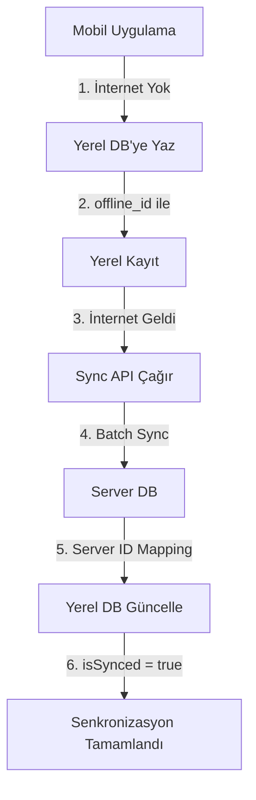

# RetinaAI Klinik - Mobil Uygulama Entegrasyon API Dokümantasyonu

## 📋 İçindekiler

1. [Genel Bakış](#genel-bakış)
2. [API Mimarisi](#api-mimarisi)
3. [Kimlik Doğrulama](#kimlik-doğrulama)
4. [Offline-First Stratejisi](#offline-first-stratejisi)
5. [Endpoint Detayları](#endpoint-detayları)
6. [Mobil Uygulama Entegrasyon Adımları](#mobil-uygulama-entegrasyon-adımları)
7. [Hata Yönetimi](#hata-yönetimi)
8. [Örnek Kullanım Senaryoları](#örnek-kullanım-senaryoları)
9. [Güvenlik](#güvenlik)
10. [Test Stratejisi](#test-stratejisi)

---

## 🎯 Genel Bakış

RetinaAI Klinik Mobil API, doktorların mobil cihazlarından hasta kayıtlarına erişmelerini, retina görüntülerini analiz etmelerini ve offline çalışmalarını sağlayan RESTful bir API'dir.

### Temel Özellikler

- ✅ **JWT tabanlı kimlik doğrulama**
- ✅ **Offline-first veri senkronizasyonu**
- ✅ **Hasta ve analiz CRUD işlemleri**
- ✅ **Batch senkronizasyon desteği**
- ✅ **Web uygulaması ile aynı PostgreSQL veritabanı**
- ✅ **Audit log ve güvenlik**

### Teknoloji Stack

- **Backend**: Next.js 15 App Router
- **Veritabanı**: PostgreSQL + Prisma ORM
- **Kimlik Doğrulama**: Custom JWT (HMAC-SHA256)
- **API Versiyonlama**: `/api/mobile/v1/*`

---

## 🏗️ API Mimarisi

### Base URL

```
https://your-domain.com/api/mobile/v1
```

### API Versiyonlama

API versiyonu URL'de belirtilir:
- **v1**: `/api/mobile/v1/*` (Mevcut)
- **v2**: `/api/mobile/v2/*` (Gelecek)

### HTTP Metodları

| Metod | Kullanım |
|-------|----------|
| `GET` | Veri okuma, listeleme |
| `POST` | Yeni kayıt oluşturma, batch işlemler |
| `PATCH` | Mevcut kaydı güncelleme |
| `DELETE` | Kayıt silme |

### Response Formatı

Tüm API yanıtları JSON formatındadır:

```json
{
  "success": true,
  "data": { ... },
  "timestamp": "2026-04-28T10:00:00.000Z"
}
```

Hata durumunda:

```json
{
  "success": false,
  "error": "Hata mesajı",
  "code": "ERROR_CODE"
}
```

---

## 🔐 Kimlik Doğrulama

### 1. Login

Mobil uygulamadan kullanıcı girişi yapmak için:

**Endpoint**: `POST /api/mobile/v1/auth/login`

**Request Body**:
```json
{
  "email": "doctor@example.com",
  "password": "password123"
}
```

**Response** (200 OK):
```json
{
  "success": true,
  "token": "eyJpZCI6ImNsdWQ....",
  "doctor": {
    "id": "clud123abc",
    "name": "Dr. Ahmet",
    "surname": "Yılmaz",
    "email": "doctor@example.com",
    "role": "DOCTOR",
    "specialty": "Oftalmoloji",
    "hospital": "Ankara Şehir Hastanesi"
  }
}
```

**Mobil Uygulamada Yapılacaklar**:
```dart
// Flutter örneği
Future<void> login(String email, String password) async {
  final response = await http.post(
    Uri.parse('$baseUrl/api/mobile/v1/auth/login'),
    headers: {'Content-Type': 'application/json'},
    body: jsonEncode({
      'email': email,
      'password': password,
    }),
  );
  
  if (response.statusCode == 200) {
    final data = jsonDecode(response.body);
    // Token'ı güvenli olarak sakla (Secure Storage)
    await secureStorage.write(key: 'auth_token', value: data['token']);
    await secureStorage.write(key: 'doctor_id', value: data['doctor']['id']);
  }
}
```

### 2. Token Doğrulama

Token'ın geçerliliğini kontrol etmek için:

**Endpoint**: `POST /api/mobile/v1/auth/verify`

**Headers**:
```
Authorization: Bearer <token>
```

**Response** (200 OK):
```json
{
  "success": true,
  "valid": true,
  "doctor": {
    "id": "clud123abc",
    "name": "Dr. Ahmet",
    "surname": "Yılmaz",
    "email": "doctor@example.com",
    "role": "DOCTOR"
  }
}
```

### 3. Token Kullanımı

Her API isteğinde token'ı header'da göndermeniz gerekir:

```dart
// Flutter örneği
Future<http.Response> authenticatedRequest(String endpoint) async {
  final token = await secureStorage.read(key: 'auth_token');
  
  return await http.get(
    Uri.parse('$baseUrl$endpoint'),
    headers: {
      'Content-Type': 'application/json',
      'Authorization': 'Bearer $token',
    },
  );
}
```

---

## 📴 Offline-First Stratejisi

### Konsept

Mobil uygulama internet bağlantısı olmadan da çalışabilmelidir. Kullanıcı:
1. Offline modda hasta ekleyebilir
2. Offline modda analiz yapabilir
3. İnternet bağlantısı geldiğinde veriler senkronize edilir

### Offline Veri Modeli

#### Yerel Veritabanı Şeması (SQLite/Hive/isar)

```dart
// Hasta modeli
class Patient {
  String id; // offline_<uuid> veya server ID
  String fullName;
  String tcNo;
  int age;
  String? gender;
  String risk;
  int? diabetesYears;
  double? hba1c;
  DateTime createdAt;
  bool isSynced; // Sunucuya senkronize edildi mi?
}

// Analiz modeli
class Analysis {
  String id; // offline_<uuid> veya server ID
  String patientId; // Hasta ID (offline veya server)
  String aiResult;
  double confidence;
  String? heatmapUrl;
  String? originalImage; // Base64 veya local path
  String? doctorNote;
  bool? isCorrect;
  String? actualResult;
  DateTime createdAt;
  bool isSynced; // Sunucuya senkronize edildi mi?
}
```

### Offline ID Stratejisi

Offline oluşturulan kayıtlar için UUID kullanılır ve `offline_` prefix'i ile işaretlenir:

```dart
String generateOfflineId() {
  return 'offline_${Uuid().v4()}';
}
```

### Senkronizasyon Akışı



---

## 📡 Endpoint Detayları

### 1. Auth Endpoints

#### 1.1 Login
- **Endpoint**: `POST /api/mobile/v1/auth/login`
- **Auth**: Hayır
- **Detay**: Yukarıda açıklandı

#### 1.2 Token Verify
- **Endpoint**: `POST /api/mobile/v1/auth/verify`
- **Auth**: Evet (Bearer Token)
- **Detay**: Yukarıda açıklandı

---

### 2. Patient Endpoints

#### 2.1 Hastaları Listele

**Endpoint**: `GET /api/mobile/v1/patients`

**Query Parameters**:
- `since` (optional): ISO8601 tarih. Bu tarihten sonra eklenen/güncellenen hastaları getirir.

**Headers**:
```
Authorization: Bearer <token>
```

**Response** (200 OK):
```json
{
  "success": true,
  "patients": [
    {
      "id": "clud123abc",
      "fullName": "Ayşe Demir",
      "tcNo": "12345678901",
      "age": 45,
      "gender": "Kadın",
      "risk": "Orta",
      "diabetesYears": 5,
      "hba1c": 7.2,
      "createdAt": "2026-04-28T10:00:00.000Z",
      "analysisCount": 3,
      "lastAnalysis": {
        "id": "clud456def",
        "aiResult": "Hafif NPDR",
        "confidence": 0.89,
        "createdAt": "2026-04-27T15:30:00.000Z"
      }
    }
  ],
  "timestamp": "2026-04-28T10:05:00.000Z"
}
```

**Flutter Örneği**:
```dart
Future<List<Patient>> fetchPatients({DateTime? since}) async {
  final token = await secureStorage.read(key: 'auth_token');
  
  String url = '$baseUrl/api/mobile/v1/patients';
  if (since != null) {
    url += '?since=${since.toIso8601String()}';
  }
  
  final response = await http.get(
    Uri.parse(url),
    headers: {
      'Authorization': 'Bearer $token',
    },
  );
  
  if (response.statusCode == 200) {
    final data = jsonDecode(response.body);
    return (data['patients'] as List)
        .map((p) => Patient.fromJson(p))
        .toList();
  }
  
  throw Exception('Hastalar yüklenemedi');
}
```

#### 2.2 Tekil Hasta Ekle

**Endpoint**: `POST /api/mobile/v1/patients`

**Headers**:
```
Authorization: Bearer <token>
Content-Type: application/json
```

**Request Body**:
```json
{
  "fullName": "Mehmet Kaya",
  "tcNo": "98765432101",
  "age": 52,
  "gender": "Erkek",
  "risk": "Yüksek",
  "diabetesYears": 10,
  "hba1c": 8.5
}
```

**Response** (200 OK):
```json
{
  "success": true,
  "patient": {
    "id": "clud789ghi",
    "fullName": "Mehmet Kaya",
    "tcNo": "98765432101",
    "age": 52,
    "gender": "Erkek",
    "risk": "Yüksek",
    "diabetesYears": 10,
    "hba1c": 8.5,
    "createdAt": "2026-04-28T10:10:00.000Z"
  }
}
```

#### 2.3 Batch Hasta Sync

**Endpoint**: `POST /api/mobile/v1/patients`

**Request Body**:
```json
{
  "patients": [
    {
      "id": "offline_uuid_123",
      "fullName": "Ali Veli",
      "tcNo": "11111111111",
      "age": 35,
      "gender": "Erkek",
      "risk": "Yok"
    },
    {
      "id": "offline_uuid_456",
      "fullName": "Fatma Yılmaz",
      "tcNo": "22222222222",
      "age": 48,
      "gender": "Kadın",
      "risk": "Orta",
      "diabetesYears": 3,
      "hba1c": 6.8
    }
  ]
}
```

**Response** (200 OK):
```json
{
  "success": true,
  "results": [
    {
      "offline_id": "offline_uuid_123",
      "server_id": "cluexyz123",
      "status": "created"
    },
    {
      "offline_id": "offline_uuid_456",
      "server_id": "cluexyz456",
      "status": "created"
    }
  ],
  "timestamp": "2026-04-28T10:15:00.000Z"
}
```

**Flutter Örneği**:
```dart
Future<Map<String, String>> syncPatients(List<Patient> patients) async {
  final token = await secureStorage.read(key: 'auth_token');
  
  final response = await http.post(
    Uri.parse('$baseUrl/api/mobile/v1/patients'),
    headers: {
      'Authorization': 'Bearer $token',
      'Content-Type': 'application/json',
    },
    body: jsonEncode({
      'patients': patients.map((p) => p.toJson()).toList(),
    }),
  );
  
  if (response.statusCode == 200) {
    final data = jsonDecode(response.body);
    
    // Offline ID -> Server ID mapping
    Map<String, String> idMapping = {};
    for (var result in data['results']) {
      if (result['status'] == 'created') {
        idMapping[result['offline_id']] = result['server_id'];
      }
    }
    
    return idMapping;
  }
  
  throw Exception('Senkronizasyon başarısız');
}
```

#### 2.4 Hasta Detay

**Endpoint**: `GET /api/mobile/v1/patients/{id}`

**Response** (200 OK):
```json
{
  "success": true,
  "patient": {
    "id": "clud123abc",
    "fullName": "Ayşe Demir",
    "tcNo": "12345678901",
    "age": 45,
    "gender": "Kadın",
    "risk": "Orta",
    "diabetesYears": 5,
    "hba1c": 7.2,
    "createdAt": "2026-04-28T10:00:00.000Z",
    "analyses": [
      {
        "id": "clud456def",
        "aiResult": "Hafif NPDR",
        "confidence": 0.89,
        "heatmapUrl": "https://...",
        "originalImage": "https://...",
        "doctorNote": "Takip önerilir",
        "isCorrect": true,
        "createdAt": "2026-04-27T15:30:00.000Z"
      }
    ]
  }
}
```

#### 2.5 Hasta Güncelle

**Endpoint**: `PATCH /api/mobile/v1/patients/{id}`

**Request Body**:
```json
{
  "age": 46,
  "hba1c": 7.0,
  "risk": "Düşük"
}
```

#### 2.6 Hasta Sil

**Endpoint**: `DELETE /api/mobile/v1/patients/{id}`

**Response** (200 OK):
```json
{
  "success": true,
  "message": "Hasta başarıyla silindi"
}
```

---

### 3. Analysis Endpoints

#### 3.1 Analizleri Listele

**Endpoint**: `GET /api/mobile/v1/analyses`

**Query Parameters**:
- `patientId` (optional): Belirli bir hastaya ait analizleri filtrele
- `since` (optional): ISO8601 tarih. Bu tarihten sonra eklenen analizleri getirir.

**Response** (200 OK):
```json
{
  "success": true,
  "analyses": [
    {
      "id": "clud456def",
      "patientId": "clud123abc",
      "patient": {
        "id": "clud123abc",
        "fullName": "Ayşe Demir",
        "tcNo": "12345678901"
      },
      "aiResult": "Hafif NPDR",
      "confidence": 0.89,
      "heatmapUrl": "https://storage.../heatmap.png",
      "originalImage": "https://storage.../original.png",
      "doctorNote": "Takip önerilir",
      "isCorrect": true,
      "actualResult": null,
      "createdAt": "2026-04-27T15:30:00.000Z",
      "aiOdriLabels": "NPDR",
      "aiOdriConfidences": "0.89",
      "drGradeInt": 1
    }
  ],
  "timestamp": "2026-04-28T10:20:00.000Z"
}
```

#### 3.2 Tekil Analiz Ekle

**Endpoint**: `POST /api/mobile/v1/analyses`

**Request Body**:
```json
{
  "patientId": "clud123abc",
  "aiResult": "Orta NPDR",
  "confidence": 0.92,
  "originalImage": "https://storage.../image.png",
  "doctorNote": "3 ay sonra kontrol"
}
```

**Response** (200 OK):
```json
{
  "success": true,
  "analysis": {
    "id": "clue111aaa",
    "patientId": "clud123abc",
    "aiResult": "Orta NPDR",
    "confidence": 0.92,
    "originalImage": "https://storage.../image.png",
    "doctorNote": "3 ay sonra kontrol",
    "createdAt": "2026-04-28T10:25:00.000Z"
  }
}
```

#### 3.3 Batch Analiz Sync

**Endpoint**: `POST /api/mobile/v1/analyses`

**Request Body**:
```json
{
  "analyses": [
    {
      "id": "offline_uuid_789",
      "patientId": "offline_uuid_123",
      "aiResult": "Normal",
      "confidence": 0.95,
      "originalImage": "base64_encoded_image_data",
      "doctorNote": "Sağlıklı retina"
    },
    {
      "id": "offline_uuid_101",
      "patientId": "clud123abc",
      "aiResult": "Hafif NPDR",
      "confidence": 0.87,
      "originalImage": "base64_encoded_image_data"
    }
  ]
}
```

**Response** (200 OK):
```json
{
  "success": true,
  "results": [
    {
      "offline_id": "offline_uuid_789",
      "server_id": "clue222bbb",
      "status": "created"
    },
    {
      "offline_id": "offline_uuid_101",
      "server_id": "clue333ccc",
      "status": "created"
    }
  ],
  "timestamp": "2026-04-28T10:30:00.000Z"
}
```

#### 3.4 Analiz Detay

**Endpoint**: `GET /api/mobile/v1/analyses/{id}`

#### 3.5 Analiz Güncelle

**Endpoint**: `PATCH /api/mobile/v1/analyses/{id}`

**Request Body**:
```json
{
  "doctorNote": "Hasta tekrar değerlendirildi, takip devam",
  "isCorrect": true,
  "drGradeInt": 2
}
```

#### 3.6 Analiz Sil

**Endpoint**: `DELETE /api/mobile/v1/analyses/{id}`

---

### 4. Sync Endpoint

#### 4.1 Toplu Senkronizasyon

**Endpoint**: `POST /api/mobile/v1/sync`

Bu endpoint, offline modda toplanan tüm verileri (hastalar + analizler) tek bir istekle senkronize eder.

**Request Body**:
```json
{
  "patients": [
    {
      "id": "offline_uuid_123",
      "fullName": "Ali Veli",
      "tcNo": "11111111111",
      "age": 35
    }
  ],
  "analyses": [
    {
      "id": "offline_uuid_456",
      "patientId": "offline_uuid_123",
      "aiResult": "Normal",
      "confidence": 0.95
    }
  ],
  "syncTimestamp": "2026-04-28T10:00:00.000Z"
}
```

**Response** (200 OK):
```json
{
  "success": true,
  "syncedAt": "2026-04-28T10:35:00.000Z",
  "results": {
    "patients": {
      "created": 1,
      "updated": 0,
      "failed": 0,
      "mapping": {
        "offline_uuid_123": "cluf444ddd"
      },
      "errors": []
    },
    "analyses": {
      "created": 1,
      "updated": 0,
      "failed": 0,
      "mapping": {
        "offline_uuid_456": "clue555eee"
      },
      "errors": []
    }
  }
}
```

**Flutter Örneği**:
```dart
Future<void> fullSync() async {
  final token = await secureStorage.read(key: 'auth_token');
  
  // Yerel DB'den senkronize edilmemiş kayıtları al
  final unsyncedPatients = await localDB.getUnsyncedPatients();
  final unsyncedAnalyses = await localDB.getUnsyncedAnalyses();
  
  if (unsyncedPatients.isEmpty && unsyncedAnalyses.isEmpty) {
    print('Senkronize edilecek veri yok');
    return;
  }
  
  final response = await http.post(
    Uri.parse('$baseUrl/api/mobile/v1/sync'),
    headers: {
      'Authorization': 'Bearer $token',
      'Content-Type': 'application/json',
    },
    body: jsonEncode({
      'patients': unsyncedPatients.map((p) => p.toJson()).toList(),
      'analyses': unsyncedAnalyses.map((a) => a.toJson()).toList(),
      'syncTimestamp': DateTime.now().toIso8601String(),
    }),
  );
  
  if (response.statusCode == 200) {
    final data = jsonDecode(response.body);
    
    // Hasta ID mapping'lerini güncelle
    for (var entry in data['results']['patients']['mapping'].entries) {
      await localDB.updatePatientId(entry.key, entry.value);
    }
    
    // Analiz ID mapping'lerini güncelle
    for (var entry in data['results']['analyses']['mapping'].entries) {
      await localDB.updateAnalysisId(entry.key, entry.value);
    }
    
    // Senkronize edildi olarak işaretle
    await localDB.markAsSynced();
    
    print('Senkronizasyon tamamlandı');
  }
}
```

#### 4.2 Sync Durumu Kontrolü

**Endpoint**: `GET /api/mobile/v1/sync?since=<ISO8601>`

**Response** (200 OK):
```json
{
  "success": true,
  "lastSync": "2026-04-28T09:00:00.000Z",
  "serverTime": "2026-04-28T10:40:00.000Z",
  "pendingChanges": {
    "patients": 2,
    "analyses": 5
  }
}
```

---

## 🔧 Mobil Uygulama Entegrasyon Adımları

### Adım 1: Proje Yapısı

```
mobile_app/
├── lib/
│   ├── models/
│   │   ├── patient.dart
│   │   ├── analysis.dart
│   │   └── sync_result.dart
│   ├── services/
│   │   ├── api_service.dart
│   │   ├── auth_service.dart
│   │   └── sync_service.dart
│   ├── database/
│   │   ├── local_database.dart
│   │   ├── patient_dao.dart
│   │   └── analysis_dao.dart
│   ├── screens/
│   │   ├── login_screen.dart
│   │   ├── patients_list_screen.dart
│   │   └── analysis_screen.dart
│   └── main.dart
```

### Adım 2: Dependencies (Flutter)

```yaml
# pubspec.yaml
dependencies:
  flutter:
    sdk: flutter
  
  # HTTP istekleri
  http: ^1.1.0
  
  # Yerel veritabanı
  sqflite: ^2.3.0
  path: ^1.8.3
  
  # Güvenli depolama
  flutter_secure_storage: ^9.0.0
  
  # State management
  provider: ^6.1.1
  
  # UUID oluşturma
  uuid: ^4.1.0
  
  # Bağlantı kontrolü
  connectivity_plus: ^5.0.2
```

### Adım 3: API Service Implementation

```dart
// lib/services/api_service.dart
import 'dart:convert';
import 'package:http/http.dart' as http;
import 'package:flutter_secure_storage/flutter_secure_storage.dart';

class ApiService {
  static const String baseUrl = 'https://your-domain.com';
  final _storage = const FlutterSecureStorage();
  
  // Auth header ekle
  Future<Map<String, String>> _getHeaders() async {
    final token = await _storage.read(key: 'auth_token');
    return {
      'Content-Type': 'application/json',
      if (token != null) 'Authorization': 'Bearer $token',
    };
  }
  
  // Login
  Future<Map<String, dynamic>> login(String email, String password) async {
    final response = await http.post(
      Uri.parse('$baseUrl/api/mobile/v1/auth/login'),
      headers: {'Content-Type': 'application/json'},
      body: jsonEncode({
        'email': email,
        'password': password,
      }),
    );
    
    if (response.statusCode == 200) {
      final data = jsonDecode(response.body);
      await _storage.write(key: 'auth_token', value: data['token']);
      return data;
    }
    
    throw Exception('Login failed: ${response.body}');
  }
  
  // Hastaları getir
  Future<List<dynamic>> getPatients({DateTime? since}) async {
    String url = '$baseUrl/api/mobile/v1/patients';
    if (since != null) {
      url += '?since=${since.toIso8601String()}';
    }
    
    final response = await http.get(
      Uri.parse(url),
      headers: await _getHeaders(),
    );
    
    if (response.statusCode == 200) {
      final data = jsonDecode(response.body);
      return data['patients'];
    }
    
    throw Exception('Failed to load patients');
  }
  
  // Sync
  Future<Map<String, dynamic>> sync({
    required List<Map<String, dynamic>> patients,
    required List<Map<String, dynamic>> analyses,
  }) async {
    final response = await http.post(
      Uri.parse('$baseUrl/api/mobile/v1/sync'),
      headers: await _getHeaders(),
      body: jsonEncode({
        'patients': patients,
        'analyses': analyses,
        'syncTimestamp': DateTime.now().toIso8601String(),
      }),
    );
    
    if (response.statusCode == 200) {
      return jsonDecode(response.body);
    }
    
    throw Exception('Sync failed');
  }
}
```

### Adım 4: Local Database (SQLite)

```dart
// lib/database/local_database.dart
import 'package:sqflite/sqflite.dart';
import 'package:path/path.dart';

class LocalDatabase {
  static Database? _database;
  
  Future<Database> get database async {
    if (_database != null) return _database!;
    _database = await _initDatabase();
    return _database!;
  }
  
  Future<Database> _initDatabase() async {
    String path = join(await getDatabasesPath(), 'retina_ai.db');
    
    return await openDatabase(
      path,
      version: 1,
      onCreate: (db, version) async {
        // Patients table
        await db.execute('''
          CREATE TABLE patients (
            id TEXT PRIMARY KEY,
            full_name TEXT NOT NULL,
            tc_no TEXT NOT NULL,
            age INTEGER NOT NULL,
            gender TEXT,
            risk TEXT,
            diabetes_years INTEGER,
            hba1c REAL,
            created_at TEXT NOT NULL,
            is_synced INTEGER DEFAULT 0
          )
        ''');
        
        // Analyses table
        await db.execute('''
          CREATE TABLE analyses (
            id TEXT PRIMARY KEY,
            patient_id TEXT NOT NULL,
            ai_result TEXT NOT NULL,
            confidence REAL NOT NULL,
            heatmap_url TEXT,
            original_image TEXT,
            doctor_note TEXT,
            is_correct INTEGER,
            actual_result TEXT,
            created_at TEXT NOT NULL,
            is_synced INTEGER DEFAULT 0,
            FOREIGN KEY (patient_id) REFERENCES patients (id) ON DELETE CASCADE
          )
        ''');
      },
    );
  }
  
  // Hasta ekle
  Future<void> insertPatient(Map<String, dynamic> patient) async {
    final db = await database;
    await db.insert('patients', patient, conflictAlgorithm: ConflictAlgorithm.replace);
  }
  
  // Senkronize edilmemiş hastaları getir
  Future<List<Map<String, dynamic>>> getUnsyncedPatients() async {
    final db = await database;
    return await db.query('patients', where: 'is_synced = ?', whereArgs: [0]);
  }
  
  // Hasta ID güncelle (offline -> server)
  Future<void> updatePatientId(String oldId, String newId) async {
    final db = await database;
    await db.update(
      'patients',
      {'id': newId, 'is_synced': 1},
      where: 'id = ?',
      whereArgs: [oldId],
    );
    
    // Analizlerdeki patient_id'leri de güncelle
    await db.update(
      'analyses',
      {'patient_id': newId},
      where: 'patient_id = ?',
      whereArgs: [oldId],
    );
  }
}
```

### Adım 5: Sync Service

```dart
// lib/services/sync_service.dart
import 'package:connectivity_plus/connectivity_plus.dart';
import 'api_service.dart';
import '../database/local_database.dart';

class SyncService {
  final ApiService _apiService = ApiService();
  final LocalDatabase _localDB = LocalDatabase();
  
  // İnternet bağlantısını kontrol et
  Future<bool> isConnected() async {
    final connectivityResult = await Connectivity().checkConnectivity();
    return connectivityResult != ConnectivityResult.none;
  }
  
  // Otomatik senkronizasyon (arka planda çalışır)
  Future<void> autoSync() async {
    if (!await isConnected()) {
      print('İnternet bağlantısı yok, sync iptal edildi');
      return;
    }
    
    try {
      final unsyncedPatients = await _localDB.getUnsyncedPatients();
      final unsyncedAnalyses = await _localDB.getUnsyncedAnalyses();
      
      if (unsyncedPatients.isEmpty && unsyncedAnalyses.isEmpty) {
        print('Senkronize edilecek veri yok');
        return;
      }
      
      print('Sync başlatılıyor: ${unsyncedPatients.length} hasta, ${unsyncedAnalyses.length} analiz');
      
      final result = await _apiService.sync(
        patients: unsyncedPatients,
        analyses: unsyncedAnalyses,
      );
      
      // ID mapping'lerini güncelle
      final patientsMapping = result['results']['patients']['mapping'] as Map<String, dynamic>;
      for (var entry in patientsMapping.entries) {
        await _localDB.updatePatientId(entry.key, entry.value);
      }
      
      final analysesMapping = result['results']['analyses']['mapping'] as Map<String, dynamic>;
      for (var entry in analysesMapping.entries) {
        await _localDB.updateAnalysisId(entry.key, entry.value);
      }
      
      print('Sync başarılı');
    } catch (e) {
      print('Sync hatası: $e');
    }
  }
  
  // Manuel senkronizasyon (kullanıcı tetikler)
  Future<Map<String, dynamic>> manualSync() async {
    if (!await isConnected()) {
      throw Exception('İnternet bağlantısı yok');
    }
    
    final unsyncedPatients = await _localDB.getUnsyncedPatients();
    final unsyncedAnalyses = await _localDB.getUnsyncedAnalyses();
    
    if (unsyncedPatients.isEmpty && unsyncedAnalyses.isEmpty) {
      return {
        'success': true,
        'message': 'Tüm veriler senkronize',
      };
    }
    
    final result = await _apiService.sync(
      patients: unsyncedPatients,
      analyses: unsyncedAnalyses,
    );
    
    // ID mapping'lerini güncelle
    final patientsMapping = result['results']['patients']['mapping'] as Map<String, dynamic>;
    for (var entry in patientsMapping.entries) {
      await _localDB.updatePatientId(entry.key, entry.value);
    }
    
    final analysesMapping = result['results']['analyses']['mapping'] as Map<String, dynamic>;
    for (var entry in analysesMapping.entries) {
      await _localDB.updateAnalysisId(entry.key, entry.value);
    }
    
    return result;
  }
}
```

### Adım 6: Offline Veri Ekleme

```dart
// lib/screens/add_patient_screen.dart
import 'package:uuid/uuid.dart';
import '../services/sync_service.dart';
import '../database/local_database.dart';

class AddPatientScreen extends StatefulWidget {
  @override
  _AddPatientScreenState createState() => _AddPatientScreenState();
}

class _AddPatientScreenState extends State<AddPatientScreen> {
  final _localDB = LocalDatabase();
  final _syncService = SyncService();
  
  Future<void> _savePatient() async {
    // Offline ID oluştur
    final offlineId = 'offline_${Uuid().v4()}';
    
    final patient = {
      'id': offlineId,
      'full_name': _nameController.text,
      'tc_no': _tcNoController.text,
      'age': int.parse(_ageController.text),
      'gender': _selectedGender,
      'risk': _selectedRisk,
      'created_at': DateTime.now().toIso8601String(),
      'is_synced': 0, // Henüz senkronize edilmedi
    };
    
    // Yerel DB'ye kaydet
    await _localDB.insertPatient(patient);
    
    ScaffoldMessenger.of(context).showSnackBar(
      SnackBar(content: Text('Hasta kaydedildi (offline)')),
    );
    
    // İnternet varsa otomatik sync dene
    if (await _syncService.isConnected()) {
      _syncService.autoSync();
    }
    
    Navigator.pop(context);
  }
  
  @override
  Widget build(BuildContext context) {
    // Form UI...
  }
}
```

---

## ⚠️ Hata Yönetimi

### HTTP Status Kodları

| Kod | Anlamı | Açıklama |
|-----|---------|----------|
| 200 | OK | İstek başarılı |
| 201 | Created | Kayıt oluşturuldu |
| 400 | Bad Request | Geçersiz istek (eksik parametreler) |
| 401 | Unauthorized | Kimlik doğrulama gerekli veya token geçersiz |
| 403 | Forbidden | Yetki yok |
| 404 | Not Found | Kayıt bulunamadı |
| 500 | Internal Server Error | Sunucu hatası |

### Hata Response Formatı

```json
{
  "success": false,
  "error": "Hasta bulunamadı veya yetkisiz",
  "code": "PATIENT_NOT_FOUND"
}
```

### Hata Yakalama (Flutter)

```dart
Future<void> fetchPatientsWithErrorHandling() async {
  try {
    final patients = await _apiService.getPatients();
    setState(() {
      _patients = patients;
    });
  } on http.ClientException catch (e) {
    // Network hatası
    ScaffoldMessenger.of(context).showSnackBar(
      SnackBar(content: Text('Bağlantı hatası: ${e.message}')),
    );
  } on FormatException catch (e) {
    // JSON parse hatası
    ScaffoldMessenger.of(context).showSnackBar(
      SnackBar(content: Text('Veri formatı hatası')),
    );
  } catch (e) {
    // Genel hata
    ScaffoldMessenger.of(context).showSnackBar(
      SnackBar(content: Text('Bilinmeyen hata: $e')),
    );
  }
}
```

---

## 🎬 Örnek Kullanım Senaryoları

### Senaryo 1: Doktor Offline Hasta Ekliyor

1. Doktor hastaneye gider, internet bağlantısı zayıf
2. Hasta bilgilerini mobil uygulamaya girer
3. Uygulama `offline_uuid_123` ile hastayı yerel DB'ye kaydeder
4. `isSynced = false` olarak işaretler
5. Retina görüntüsü çeker, AI analizi yapar (offline)
6. Analiz sonucunu `offline_uuid_456` ile yerel DB'ye kaydeder
7. Doktor ofise döndüğünde WiFi'ya bağlanır
8. Uygulama otomatik sync başlatır
9. `/api/mobile/v1/sync` endpoint'ine toplu istek gönderir
10. Server yanıt verir: 
    - `offline_uuid_123` -> `cluf444ddd` (server ID)
    - `offline_uuid_456` -> `clue555eee` (server ID)
11. Uygulama yerel DB'yi günceller, `isSynced = true` yapar

### Senaryo 2: Web ve Mobil Aynı Anda Kullanılıyor

1. Doktor web uygulamasından hasta ekler
2. Mobil uygulama periyodik sync yapar (her 5 dakika)
3. `GET /api/mobile/v1/patients?since=<lastSyncTime>` isteği gönderir
4. Yeni hastaları indirir ve yerel DB'ye ekler
5. Doktor mobil uygulamadan yeni hastayı görür

### Senaryo 3: Çakışma Yönetimi

1. Hasta hem web'de hem mobil'de aynı anda güncelleniyor
2. Mobil offline modda hastanın yaşını 45 yapıyor
3. Web'de aynı hasta 46 yaşına güncelleniyor
4. Mobil sync yaparken server'daki veri daha güncel
5. **Strateji**: "Last Write Wins" - en son yazma kazanır
6. Alternatif: Kullanıcıya çakışma bildirimi göster

---

## 🔒 Güvenlik

### 1. HTTPS Zorunluluğu

Production ortamında **HTTPS** kullanımı zorunludur:

```dart
// Flutter'da sadece HTTPS'e izin ver
class ApiService {
  static const String baseUrl = 'https://your-domain.com'; // ✅
  // static const String baseUrl = 'http://your-domain.com'; // ❌
}
```

### 2. Token Güvenli Depolama

Token'ları `SharedPreferences` yerine `FlutterSecureStorage` ile saklayın:

```dart
// ✅ Güvenli
final storage = FlutterSecureStorage();
await storage.write(key: 'auth_token', value: token);

// ❌ Güvensiz
final prefs = await SharedPreferences.getInstance();
prefs.setString('auth_token', token);
```

### 3. Token Yenileme

Token süresi dolduğunda kullanıcıyı tekrar login sayfasına yönlendirin:

```dart
Future<http.Response> _handleResponse(http.Response response) async {
  if (response.statusCode == 401) {
    // Token süresi dolmuş
    await _storage.delete(key: 'auth_token');
    // Login sayfasına yönlendir
    navigateToLogin();
  }
  return response;
}
```

### 4. SSL Pinning (İleri Seviye)

Man-in-the-middle (MITM) saldırılarına karşı koruma:

```dart
import 'package:flutter/services.dart';
import 'dart:io';

SecurityContext getSecurityContext() {
  final context = SecurityContext.defaultContext;
  final certBytes = rootBundle.load('assets/certificates/cert.pem');
  context.setTrustedCertificatesBytes(certBytes as Uint8List);
  return context;
}
```

---

## 🧪 Test Stratejisi

### 1. Unit Tests

```dart
// test/services/api_service_test.dart
import 'package:flutter_test/flutter_test.dart';
import 'package:mockito/mockito.dart';

void main() {
  group('ApiService Tests', () {
    test('Login should return token on success', () async {
      final apiService = ApiService();
      
      final result = await apiService.login(
        'doctor@example.com',
        'password123',
      );
      
      expect(result['success'], true);
      expect(result['token'], isNotNull);
    });
    
    test('Login should throw exception on invalid credentials', () async {
      final apiService = ApiService();
      
      expect(
        () => apiService.login('invalid@example.com', 'wrong'),
        throwsException,
      );
    });
  });
}
```

### 2. Integration Tests

```dart
// test/integration/sync_test.dart
void main() {
  testWidgets('Offline patient should sync when online', (tester) async {
    // Offline hasta ekle
    final localDB = LocalDatabase();
    await localDB.insertPatient({
      'id': 'offline_test_123',
      'full_name': 'Test Patient',
      'tc_no': '12345678901',
      'age': 30,
      'is_synced': 0,
    });
    
    // Sync çalıştır
    final syncService = SyncService();
    await syncService.autoSync();
    
    // Senkronize edildi mi kontrol et
    final patients = await localDB.getUnsyncedPatients();
    expect(patients.length, 0);
  });
}
```

### 3. E2E Tests (Postman/Newman)

```json
{
  "name": "RetinaAI Mobile API Tests",
  "requests": [
    {
      "name": "Login",
      "request": {
        "method": "POST",
        "url": "{{baseUrl}}/api/mobile/v1/auth/login",
        "body": {
          "email": "test@example.com",
          "password": "test123"
        }
      },
      "tests": [
        "pm.test('Status code is 200', () => pm.response.to.have.status(200))",
        "pm.test('Response has token', () => pm.response.to.have.jsonBody('token'))"
      ]
    }
  ]
}
```

---

## 📝 Sonuç ve Öneriler

### Tamamlanan Özellikler

✅ **Auth API**: Login ve token doğrulama  
✅ **Patient API**: CRUD + batch sync  
✅ **Analysis API**: CRUD + batch sync  
✅ **Sync API**: Toplu offline senkronizasyon  
✅ **Audit Logging**: Tüm işlemler loglanır  

### Gelecek Geliştirmeler

🔜 **Dosya Upload**: Görüntü upload endpoint'i  
🔜 **Push Notifications**: Senkronizasyon bildirimleri  
🔜 **Conflict Resolution**: Gelişmiş çakışma yönetimi  
🔜 **Pagination**: Büyük veri setleri için sayfalama  
🔜 **Rate Limiting**: API isteklerini sınırlandırma  

### İletişim ve Destek

Bu API dokümantasyonu konusunda sorularınız için:
- **Email**: support@retinaai-klinik.com
- **Docs**: https://docs.retinaai-klinik.com

---

**Son Güncelleme**: 28 Nisan 2026  
**API Versiyonu**: v1.0.0  
**Doküman Versiyonu**: 1.0
